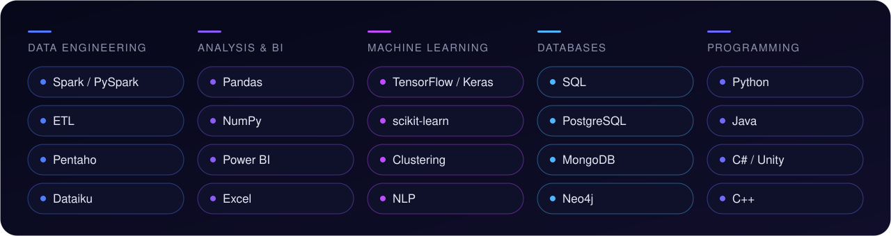
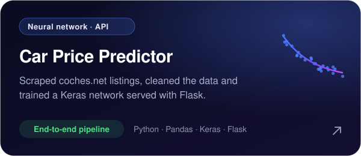
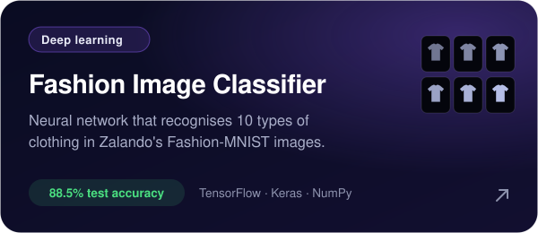
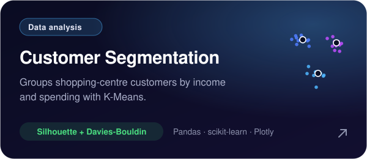
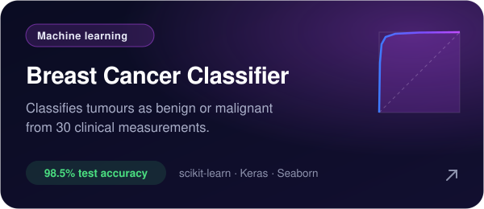
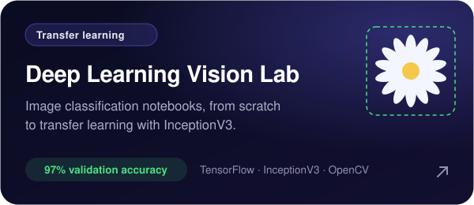
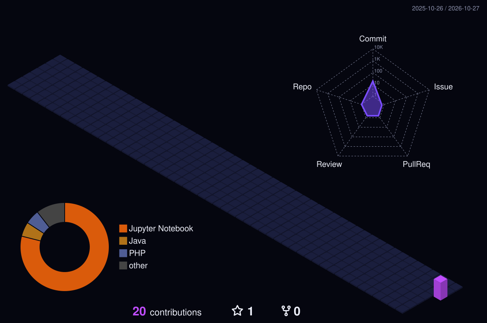

  

  
  
  

### About me

I'm a **data engineer and data analyst** based in Granada, Spain. I turn data into insights, models and products.

- Developer at **Vircell** (2023 – 2026): data models and databases, data processing and analysis, process automation and software testing.
- Specialisation in **Artificial Intelligence & Big Data** · Higher Technician in **Networked Systems Administration** (Cisco CCNA) · Training in **VR / AR & IoT for 5G**.
- Languages: Spanish · English (B1).

### Tech stack

  

### Featured projects

  
  

  
  

  
  

<b>More experiments</b> · clustering, decision trees, k-NN, neural networks, NLP and AWS

 

| Repository | What it does |
| --- | --- |
| [kmeans_paises](https://github.com/Steven-Macas/kmeans_paises) | Groups countries by socio-economic and health indicators with K-Means |
| [kmeans_COD](https://github.com/Steven-Macas/kmeans_COD) | Clusters Call of Duty players by their in-game statistics |
| [Red-Neuronal](https://github.com/Steven-Macas/Red-Neuronal) | Customer churn prediction with a Keras neural network |
| [Automobile-Red-Neuronal](https://github.com/Steven-Macas/Automobile-Red-Neuronal) | Price regression on the UCI Automobile dataset |
| [random-forest](https://github.com/Steven-Macas/random-forest) | Random Forest with GridSearchCV and AdaBoost (Bike, Wine) |
| [ArbolDecision](https://github.com/Steven-Macas/ArbolDecision) | Classification and regression trees on four datasets |
| [SAA](https://github.com/Steven-Macas/SAA) | k-Nearest Neighbours for wine quality, heart disease and housing |
| [redes-neuronales-SAA](https://github.com/Steven-Macas/redes-neuronales-SAA) | Neural networks for wine quality and heart failure |
| [PLN](https://github.com/Steven-Macas/PLN) | Text preprocessing with NLTK: tokenisation, stopwords, POS tags |
| [Django-AWS](https://github.com/Steven-Macas/Django-AWS) | Django image gallery with storage on Amazon S3 |

### Contribution city

  

Ideas → Products · <a href="https://gointy.com">gointy.com</a>

